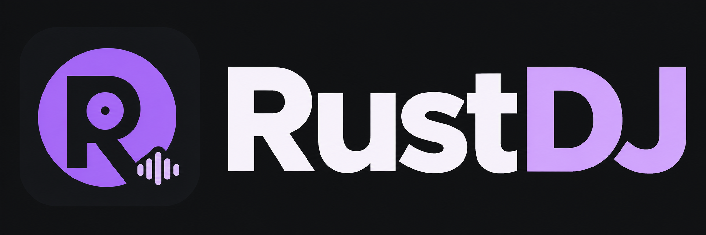

<p align="center">
  
</p>

# RustDJ 0.24.6

RustDJ is a desktop DJ and broadcasting app for Windows and Linux. Mix with
two or four decks, browse your music, and send the master mix to SHOUTcast
while recording it locally. See the [changelog](CHANGELOG.md) for version history.


## Features

- **Mixing.** Two- and four-deck layouts, scrolling three-band waveforms,
  eight hotcues and eight beat-loop buttons per deck, plus EQ, filters and effects.
- **Library.** A dedicated browser view, BPM and key analysis, an editable
  beatgrid, M3U8 playlists, and a set history with CSV export.
- **Live audio.** Independent master and headphone routing, two external
  inputs, a dedicated microphone channel, Talkover, four jingle pads, a
  10-band master EQ and a master limiter.
- **Broadcasting.** SHOUTcast profiles with protected passwords, verified TLS,
  optional track titles, reconnect and independent MP3 recording.
- **Controllers.** MIDI Learn, custom mappings, LED feedback on supported
  controllers, and Pioneer, Roland and Numark presets. [Controller setup](CONTROLLERS.md)

## Getting started

On Linux Mint, Ubuntu or Debian, [build a Debian package](#linux). From the
repository root, install the amd64 package and launch RustDJ from the
application menu or run `rustdj`.

```bash
sudo apt install ./outputs/rustdj_0.24.6_amd64.deb
```

The Linux build was tested on Linux Mint 22.3, which uses an Ubuntu 24.04
base. Build on the distribution you plan to support if it uses older system
libraries. The package filename includes the target architecture.

On Windows, [build from source](#windows) and start
`target\release\rustdj.exe`. Rust is needed to build the application.
The installed Linux package and Windows release executable run on their own.

1. Open **Audio / Outputs** and select the master output for your speakers.
2. Select a separate headphone device or a different stereo channel pair.
3. Use **Folder …** in the music browser to choose your music folder.
4. Select a track and click the number of the deck you want, or drag the track onto it.
5. Press **PLAY**. Adjust channel levels and the always-visible **MASTER** control.

The header shows the controller as **ON** or **OFF**, the selected sound cards
and their channel pairs. Connect the DJ-202 by USB before or after starting
RustDJ; automatic connection is enabled by default.

## Layout and mixing

Use **2 Decks** and **4 Decks** in the header to switch layouts. The two-deck
layout shows Decks 1 and 2, their mixer channels, waveforms and load buttons.
Pause Decks 3 and 4 before switching. Their tracks stay loaded and are
available again when you return to four decks. RustDJ remembers the layout.

In the four-deck layout, decks, mixer channels and scrolling waveform lanes
follow the same order:

```text
Deck 1   Deck 3   [ central mixer ]   Deck 4   Deck 2
purple   pink                         turquoise yellow
```

On each deck, the hotcue and beat-loop banks sit next to the filter and effects.
The two banks sit side by side when the deck is wide enough and stack on narrower
windows.

Each mixer channel has **HIGH**, **MID** and **LOW** EQ controls stacked
vertically. **GAIN**, the channel fader, its meter and headphone **CUE** sit
alongside them. Gain and the three EQ bands range from -24 to +12 dB.
Double-click an EQ or gain knob to reset it to 0 dB.

**MASTER**, **SPEAKERS**, **HEADPHONES** and **CUE / MASTER** remain visible in
both central mixer tabs. Their values are saved automatically.

- **MASTER** controls the speaker mix, SHOUTcast stream and MP3 recording.
- **SPEAKERS** adjusts only the local speaker output.
- **HEADPHONES** controls the selected headphone output.
- **CUE / MASTER** blends pre-fader cue audio with the program mix in headphones.
  The headphone program mix is taken before the software master level, so it
  remains available when MASTER is at zero.
- Channel **CUE** enables pre-fader monitoring independently of the channel fader
  and crossfader. Play the track or hold transport CUE to hear a preview.

The crossfader groups decks **1/3** on the left and **4/2** on the right. Turning
**CROSSFADER** off centers it and ignores MIDI, keyboard and mouse position
changes. All four channel faders remain independent. Re-enabling it starts from
the center. The enabled/disabled setting is saved.

Channel meters show peak levels after gain/EQ and before the channel fader.
Master and headphone stereo meters measure the actual summed output on each
selected channel pair. Numeric values are in dBFS. Silence appears as **−∞**.
**CLIP** indicates peaks at or above 0 dBFS.

### Master equalizer

Click **EQ** in the central mixer to open the additional **10-Band Master
Equalizer**. It provides ten bands at approximately 31, 63, 125, 250 and 500 Hz,
and 1, 2, 4, 8 and 16 kHz, each with -12 to +12 dB of adjustment. There is also
a preamp, an enable switch and **Flat / Reset**.

The master EQ processes the combined speaker output, stream and recording.
Direct headphone cue remains independent. Enable state, preamp and all band
values are saved and restored after restarting or changing audio devices.

### Filters and effects

Each deck has a combined low-pass/high-pass **FILTER**: center is off, left is
low-pass and right is high-pass. Three effect buttons enable **Flanger**, **Reverb**
and **Echo**, with one shared **FX LEVEL** control per deck. The compact button
labels are **FLG**, **REV** and **ECHO**. Double-click a control to reset it.
Changes are smoothed and affect both master and cue audio.

## Music browser and analysis

Use **Library** in the header to give the music browser and session list more
room while tracks continue playing. Click it again to restore the decks,
mixer and scrolling waveforms. The browser shows drives, folders and supported
music files. Use **Up** to open
the parent folder, **Go** to open a typed path, and **Favorite +** to bookmark the
current folder. The last folder and favorites are saved between sessions.
Double-click a folder to open it. Type into **Search collection …** above
the file list to find tracks across the library. Search matches parts of
filenames, paths and embedded tags such as title, artist, album and genre.
Multiple words must all match. Click **Collection** to browse indexed
tracks or return to the current folder.

Right-click a folder in the tree and choose **Add to collection and scan**.
RustDJ includes nested folders and reads tags, BPM and key in the
background. Previously analyzed tracks are already in the collection.
RustDJ fills in missing tags in the background when the collection opens.
Cancel a scan to stop the queue while keeping completed results.

To empty the music database, open **Collection** and click
**Clear collection …**. Confirm to remove all indexed entries and cached
analyses. RustDJ keeps the source files, playlists, hotcues, manually corrected
beatgrids and set history. Scanning a folder or loading a track indexes it again.

RustDJ decodes MP3, FLAC, WAV, Ogg, M4A, AAC and AIFF. The file list shows
duration, BPM, key, analysis state, format and size.
Beat analysis detects transients separately in the bass, mid and high bands.
It estimates a constant tempo from recurring accents and aligns the grid with
the detected beats. This follows the general onset and autocorrelation
approach described in [Ellis's beat tracking paper](https://labrosa.ee.columbia.edu/~dpwe/pubs/Ellis06-beattrack.pdf).
Check the grid before relying on Sync, especially for tracks with a varying
tempo. Key information includes conventional notation and Camelot.

- **Analyze selection** analyzes selected audio.
- **Reanalyze selection** replaces the cached result for that selection.
- **Analyze missing (N)** processes new or changed files in the current folder.
- The progress bar shows completed files and the current track. **Cancel** stops
  the queue; completed results remain available.

Analysis runs in background workers. The SQLite database caches BPM, key,
waveform data and file fingerprints. Unchanged files reuse saved results;
changed files or analysis versions are analyzed again. Older cached tracks can
have their detailed frequency waveforms added when loaded.

The large waveform area scrolls during playback. Use **+ / -** to change the
visible time range from 1 to 16 seconds; the default is 4 seconds. Low frequencies
are purple, mids are green and highs are light purple, independently of deck
accent colors. Close zoom levels show additional beat subdivisions. Small deck
waveforms give a full-track overview.

## Playlists and drag-and-drop

Use **PLAYLIST** to create, load or save an M3U8 playlist. **Save as …** chooses a
new file. RustDJ asks how to handle unsaved changes before replacing a playlist.
M3U/M3U8 files must be UTF-8 encoded and reference local music; HLS streams and
remote URLs are not supported.

**+ Files …** adds multiple tracks. **Up**, **Down**, **Remove** and dragging let
you organize entries. Playlists preserve order and allow repeated tracks.
Missing files remain visible with a warning so their paths can be corrected.
Relative paths, spaces and Unicode names are supported.

The **AutoDJ** tab has its own saved playlist. Right-click a track in the
browser and choose **Add to AutoDJ**, drag tracks onto the tab, or use
**Add selection**, **Files …** and **Add playlist** to build the list.
Select an entry to reorder or remove it while AutoDJ is stopped. Choose a deck
in the AutoDJ tab and press **Start AutoDJ**. RustDJ shows that deck, loads the
first track and starts it automatically. While the current track plays, AutoDJ
prepares the next entry in the background. At the end of the track, it plays
that entry on the same deck. The deck fader, crossfader and master
volume control the sound. **Next** skips a track. **Stop** in AutoDJ or on the
deck ends the run and cancels a pending track. AutoDJ skips unavailable files
and stops after the last track. Manually loading the AutoDJ deck takes it back
for manual playback.

**SESSION / SIDELIST** contains tracks successfully loaded during this session,
with each path listed once. Search filters the session list. The sidelist width
can be changed using its divider.

Drag tracks from the browser, playlist or sidelist onto any deck. Drop tracks
onto **PLAYLIST** or **SESSION**, including their tabs, to add them to a list.
An insertion line shows where a playlist item will be placed. Dragging within a
playlist reorders it; dragging onto a deck loads it. Adding tracks to a list does
not start playback or remove the original files. Escape cancels an active drag.

In the browser, collection, **PLAYLIST** and **AutoDJ**, click a track and
Shift-click another to select every track between them. Drag any highlighted
track to move the entire selection in its displayed order. Within the same
playlist the selection moves as a block. Stop AutoDJ to reorder its list.
When dropping a selection on a deck, tracks fill the visible decks in order
starting with the target.

Files from the desktop file manager can also be dropped onto decks and lists. Dropping
multiple files onto a deck loads up to four decks in display order, starting at
the target. Dropping a folder opens it in the music browser.

## Transport, hotcues, loops and Sync

Every deck has PLAY/PAUSE, STOP, transport CUE, tempo and Sync controls.
Hold transport **CUE** to preview from the cue point; releasing returns to it.
Pressing PLAY while cueing latches playback. Right-click transport CUE to set
the cue point. This differs from the mixer headphone CUE switch.

Eight hotcue buttons are available per deck. An empty button saves the current
position; an assigned button jumps to it and starts playback. Shift-click or
right-click clears a hotcue. Hotcues are stored per file in SQLite and restored
when the unchanged file is loaded again.

The eight direct loop buttons select **1/4, 1/2, 1, 2, 4, 8, 16 or 32 beats**.
Valid BPM is required. Press the active length again to exit, or another length
to resize the loop. The DJ-202 PARAM -/+ buttons halve or double its length.
Prepared PCM loops repeat on both master and headphones without a UI-thread
seek at each boundary. Manual IN/OUT, reloop and additional actions remain
available through MIDI learn.

Use a deck's BPM menu to set or correct BPM, halve/double it, tap tempo or set
the beat at the current position. Tempo ranges from 50% to 200%. Sync chooses
another loaded deck as reference, preferring a playing deck with a higher master
contribution. Multiple decks can follow a reference. Manual tempo changes,
jogging, hotcue jumps and loop jumps release that deck's Sync relationship.
During playback, a jogwheel turn briefly speeds up or slows down its deck and
then returns to the selected tempo. On a paused deck, turning the wheel moves
the cueing position by 15 ms per MIDI tick.

## Audio outputs and headphone monitoring

**Audio / Outputs** lets you choose the master device and a separate monitoring
output. With two stereo devices, select channels 1/2 on each. With a multichannel
interface, use different pairs, such as master 1/2 and phones 3/4. The audio backend must expose the needed channels. Linux uses ALSA for audio
and MIDI. Overlapping pairs on one device are
rejected. Missing devices are not silently replaced with other outputs.

The **MASTER / PHONES** mixer tab also provides a headphone device/pair selector.
Click **Apply** to save and use that output. The master selection remains intact.
Click **…** or the headphone status in the header to open all audio settings.

To preview a second track while one is playing publicly:

1. Load the second track and close its channel fader.
2. Enable that channel's mixer **CUE**.
3. Move **CUE / MASTER** toward Cue and raise **HEADPHONES**.
4. Play the second track or hold its transport CUE.

Different sound cards and Bluetooth devices may have different latencies.
RustDJ tracks both playback clocks and corrects headphone drift without moving
the public master. Stop streaming and recording before changing audio routing.

## Controller profiles and MIDI

**Controller / MIDI** provides model-specific presets for Pioneer DDJ-400,
DDJ-FLX4 and DDJ-SX, Roland DJ-202 and DJ-505, Numark Mixtrack (Pro) 3 and Mixtrack Platinum
FX. **Generic MIDI / Learn** starts without assumed manufacturer addresses.
See [CONTROLLERS.md](CONTROLLERS.md) for the exact scope and source references.

Choose **Automatic (known models)** or select a profile explicitly. Automatic
connection uses a saved preferred port, or exactly one matching supported device.
If several supported devices are present, choose a port manually. Unknown devices
are not auto-connected; when connected manually they use Generic MIDI / Learn.

Every model keeps its own learned bindings, including empty mappings. Switching
profiles preserves changes and releases held Cue controls. **Reset profile**
restores only the selected model's defaults. **Export JSON …** saves a RustDJ
profile and **Import JSON …** loads a validated one. Import rejects unsupported
versions, overlapping addresses, invalid deck/pad indices and oversized files.
The format is specific to RustDJ; Mixxx XML and rekordbox presets are not imported.

Initialization and LED output are sent only when the selected profile matches
the actual port's model. Pioneer and Numark cannot accidentally receive Roland's
pad unlock commands. Each profile uses its documented resolution, relative
encoder format and tempo direction. Audio routing remains a separate setting;
choose sound cards and channel pairs in **Audio / Outputs**.

These are USB MIDI presets with automated message tests, not a guarantee that
every hardware function is supported. HID-only equipment, DVS, proprietary jog
displays, hardware sequencers and standalone analog mixer paths are not covered.
Physical verification of the additional models remains outstanding.

### Existing Roland DJ-202 support

RustDJ automatically discovers the DJ-202 and reconnects after USB disconnection.
**Controller / MIDI** allows manual device selection, connection, disconnection,
refreshing ports and disabling auto-connect. A manually selected preferred port
is remembered; another unrelated MIDI device is not used as a fallback.

The left **DECK 3** button switches decks **1/3**, and the right **DECK 4** button
switches **2/4**. Native MIDI channels map directly to their numbered decks in
both switch directions. Shared FX and Load controls follow the selected bank.
Held transport CUE is released on its original deck even after a bank switch.

The profile covers transport, jog, tempo, gain, three-band EQ, channel faders,
filter, FX, headphone CUE, browser navigation, loading and all eight hotcue/loop
pads. Play, Sync, cue, pad and bank LEDs reflect software state when the MIDI
output is available. Older profiles are extended while custom mappings remain.

Press **HOT CUE** or **LOOP** on the controller before using pads 1–8. HOT CUE
sets an empty slot or triggers an assigned one; SHIFT+pad clears it. LOOP uses
the eight direct lengths. RustDJ unlocks the controller's pad layers and displays
the reported pad mode in the MIDI window. Initialization/output errors are shown.

**MIDI-LEARN** supports assigning actions to other controls. Select an action,
choose the appropriate button/fader or relative-encoder mode, click **Learn**,
and move or press the control. The last MIDI bytes and action help diagnose
assignments. **Reset profile** restores defaults for the active model.

The DJ-202's physical MASTER LEVEL is a hardware output control; a software MIDI
CC is not invented for it. Use RustDJ's MASTER control when sending to another
sound card. Hardware and software headphone levels may both affect listening
volume. The base profile includes Phones CC 0C and Mixing CC 0D if the device
sends them. Controllers that transmit a master CC can assign it with MIDI learn.

MIDI addresses were researched from the
[controller author's mapping](https://github.com/Lykos153/mixxx/tree/Mapping-DJ-202/res/controllers)
and [Mixxx device article](https://github.com/mixxxdj/mixxx/wiki/Roland-Dj-202).
The Rust implementation is independent. See also the
[DJ-202 mixer controls](https://virtualdj.com/manuals/hardware/roland/dj202/layout/mixer.html).
A complete physical test of every DJ-202 control is still outstanding.

## Microphone and external audio inputs

Choose the microphone device and channel under **Audio Inputs → Microphone**.
Use **MIC OFF / MIC ON** in the mixer to toggle it during a set. The adjacent
slider sets the microphone level, and the meter shows that signal after the
slider. The microphone feeds the master mix, including the stream and recording,
and starts switched off each time RustDJ opens.

Open **Audio Inputs** in the header to set up two independent inputs for
microphones, line-in or USB audio interfaces. Choose an input device and a
mono channel or stereo pair, adjust **Input level**, then click **Enable input**.
The inputs feed the master mix and are included in SHOUTcast and MP3 recordings.
They are also audible in the headphone program mix. The input settings are
remembered, and both inputs start disabled when RustDJ opens.

## SHOUTcast streaming and MP3 recording

Start or stop a stream or MP3 recording from the live bar in the main window.
It stays visible in Library view and shows the current broadcast and recording
state, elapsed time, and the retry countdown. The microphone switch, level
control and meter are alongside them. **CLIP** flags overload at the input,
even when the microphone fader is turned down. Hover over a broadcast or
recording status for details, including the recording file or connection errors. Click **STREAMER**
in the central mixer to open **SHOUTcast / MP3 Recording** and edit its settings.

Use **New profile** in **STREAMER** to save another destination. Give it a
name, enter its host, ports and stream ID, and select the desired profile
before starting the broadcast. RustDJ remembers the selected profile. Each
profile has its own protected password. The previous single destination
becomes the **Default** profile.

Both features capture the stereo master after channel processing,
crossfader, master EQ and the optional limiter. Enabled microphones, external
inputs and playing jingles are part of that mix. Headphone cue has its own bus.
**MASTER** sets the program level for streaming, recording and the speaker mix.
The mixer's **SPEAKERS** control adjusts the local output after the capture tap,
so it can mute the speakers without lowering the stream, recording or headphones.
Existing configurations start with **SPEAKERS** at 100%.

Enter the hostname/IP, source port, metadata/admin port, stream ID, source
password and optional station details. **TLS (certificate verified)** is the
default transport for both the source connection and HTTPS metadata updates,
including when loading settings saved by older versions. Use your provider's
TLS-enabled ports and a hostname matching the certificate. Legacy ports such as
8001/8000 may not support TLS. The source protocol is SHOUTcast 1-compatible and
supports DNAS 2 stream IDs; TLS requires a compatible source endpoint or a TLS
proxy. RustDJ is a source client, not a built-in listener server.

TLS 1.2/1.3 uses rustls and bundled Mozilla trust roots. The certificate chain,
validity and hostname/IP are checked before sending any source password or
metadata request. Invalid, expired and untrusted certificates abort the affected
connection. There is no automatic fallback to plaintext and no certificate
verification bypass. A TLS failure does not interrupt an independent MP3 recording.

**Unencrypted legacy TCP / HTTP** must be selected explicitly. A warning remains
visible and the start button changes to **Start unencrypted stream**. In this
mode, both source credentials and metadata credentials are visible to anyone
able to read the network traffic. Use it only on a trusted local connection or
inside a separately secured tunnel. See [SECURITY.md](SECURITY.md).

Enable **Send track titles to the server** for optional metadata. Automatic mode
uses the filename-derived title of the playing deck with the highest master
contribution; a manual title is also available. A metadata error does not stop
the audio stream. The source password is also used for metadata updates, so the
server must permit it for that purpose. The SHOUTcast admin API still receives
the password as a query parameter inside HTTPS. TLS hides it on the wire;
server or reverse-proxy access logs may record the URL and must redact it.

MP3 output is stereo at 44.1 kHz with selectable CBR **128, 192, 256 or 320 kbit/s**.
Bitrate changes apply to newly started sessions. Streaming and recording run
independently. A stream connection failure does not stop an active recording.

Choose a recording folder and click **Start MP3 recording**. The default for new
settings is `Music/RustDJ-Recordings` in your home folder. Files are named
`RustDJ-Master-<timestamp>-<number>.mp3`; existing files are not overwritten.
**Stop recording** finalizes the MP3. Close normally to allow pending data to flush.

Settings are saved, including transport security, ports, station details, title options, bitrate and
recording folder. Windows protects the password with DPAPI and restores it
at startup. On Linux, enter the source password and click **Save password**
under **STREAMER**. RustDJ restores it from the system keyring on startup.
The desktop needs a Secret Service provider, such as GNOME Keyring.
**Remove saved password** deletes the selected profile's keyring entry.
Streaming and recording never start automatically.

Audio capture uses bounded buffers and background workers for encoding, disk
writes and networking. The header and streamer window report connection and
recording errors. Enable reconnect per profile to retry a dropped broadcast.
The main window shows the error, the time until the next retry and whether local
recording continues.

## Live tools

- **Talkover** in the header lowers the deck and external-input music while
  you speak into the enabled microphone. Set the microphone threshold,
  reduction and return time in the Talkover window.
- **Jingles** has four saved audio pads and a dedicated level. Use **Choose
  file …** to assign a clip. Trigger it with **Play** or MIDI Learn's **Jingle
  1–4** actions. Jingles go to the master, stream and recorder.
- **Reconnect after a connection drop** under **STREAMER** makes up to five
  attempts after loss of an active broadcast. The header shows retry status,
  **Stop stream** cancels it, and recording continues independently.
- **History** lists recent plays in local time and exports the full list as CSV
  with UTC timestamps. RustDJ adds an entry once a loaded track has played for
  two consecutive seconds in the master mix.
- Open **Beatgrid editor …** in the deck's BPM menu to set the tempo and first
  beat. **Save beatgrid** stores the correction for the file. **Use detected
  grid** removes the correction. The editor uses a fixed tempo.
- **Limiter** in the mixer limits stereo sample peaks to −1 dBFS after the
  master EQ. Speakers, stream and recording share the limited signal. **LIM**
  displays the current gain reduction in dB.

## Keyboard shortcuts

| Key | Action |
| --- | --- |
| 1 / 2 / 3 / 4 | Select the active deck |
| A / B | Aliases for decks 1 / 2 |
| Space | Play/pause the active deck |
| S | Toggle Sync for the active deck |
| C | Return to the transport cue point and pause |
| Escape | Stop all decks and reset their positions |
| Left / Right arrow | Move the crossfader when enabled |

Clicking a deck selects it. Playback shortcuts are suppressed while entering
text. Transport cues, quick BPM edits and the sidelist belong to the current
session. **Save beatgrid** in the BPM editor stores tempo and first-beat
corrections across sessions, alongside persistent hotcues and analyses.

## Settings and data

Preferences include the deck layout, browser favorites, MIDI mappings,
input and output routing, stream profiles and live-tool settings. Windows
stores preferences in `%APPDATA%\RustDJ\settings.json`. Linux uses
`${XDG_CONFIG_HOME:-$HOME/.config}/RustDJ/settings.json`.

SQLite stores track analyses, waveforms, hotcues, beatgrid corrections and
set history. The Windows database defaults to `%APPDATA%\RustDJ\library.sqlite3`.
On Linux it is at `${XDG_DATA_HOME:-$HOME/.local/share}/RustDJ/library.sqlite3`.
RustDJ continues to use an existing Linux database in `~/.config/RustDJ` if
the new location is empty. Set `RUSTDJ_DATA_DIR` to choose a library directory.

## Building from source

`rust-toolchain.toml` pins Rust 1.99.1 with rustfmt and Clippy. Cargo downloads
dependencies using the versions in `Cargo.lock`.

### Linux

Install the build dependencies on Debian-based systems, then run Cargo or
build a Debian package. Run these commands from the repository root.

```bash
sudo apt install build-essential pkg-config libasound2-dev autoconf automake libtool libsecret-1-0 dpkg-dev python3
cargo run --locked
./scripts/build-deb.sh
```

The package is written to `outputs/` by default. Pass a directory as the
first argument to put it elsewhere. Build on the oldest Linux distribution
you intend to support so the binary uses that system's libraries.

### Windows

Install Rust with the MSVC target, Visual Studio C++ Build Tools and the
Windows SDK.

```powershell
git clone https://github.com/DDynamic-Evolution/RustDJ.git
cd RustDJ
.\dev.ps1 run
.\dev.ps1 clippy
.\dev.ps1 build -Release
```

With a regular Rust installation, `cargo run` and `cargo build --release` also
work. `dev.ps1` uses an existing local `.tools` toolchain when available.

The two targeted DDJ-SX regression tests for version 0.23 run with:

```powershell
cargo test --lib sx23_
```

They include the existing controller-profile regressions and exercise all
preset bindings, native SX deck/pad channels, 14-bit mixer/filter/tempo,
FX bank isolation, Cue release after deck/profile changes, saved mappings,
JSON import/export and model detection (including SX2/SX3 exclusion). Existing TLS security
regressions remain available through `cargo test --lib tls20_`.
The MIDI bank regression can also be run with `cargo test --lib regression18_native`.
A full test run is available through `cargo test` or `.\dev.ps1 test`.
The hardware audio test is ignored by default and can be requested with
`cargo test --test audio_device -- --ignored --nocapture`.

The original demo WAV files are generated with `python scripts/generate_demos.py`.
The committed compressed test fixtures can be regenerated with FFmpeg:

```powershell
ffmpeg -y -i assets/demo-a.wav -c:a libmp3lame -b:a 192k assets/demo-a.mp3
ffmpeg -y -i assets/demo-b.wav -c:a flac assets/demo-b.flac
```

Build files, tokens, recordings and local settings are excluded by `.gitignore`.
The `work/` folder is used for local checks and packaging and is not committed.

## Project structure

| Module | Purpose |
| --- | --- |
| `app`, `browser`, `playlist`, `dragdrop` | Desktop UI and library workflow |
| `branding`, `assets/branding`, `build.rs` | Embedded logo, window icon and Windows executable resources |
| `audio`, `output`, `inputs`, `dsp`, `effects`, `equalizer`, `loops` | Playback, live inputs, routing and signal processing |
| `broadcast_mix`, `jingles` | Talkover, master limiting and jingle pads |
| `midi`, `decks` | Controller mapping and deck identity |
| `track`, `analysis`, `beat`, `key`, `waveform` | Decoding and track analysis |
| `database`, `performance`, `settings`, `credentials` | Analyses, beatgrid corrections, set history, preferences and protected passwords |
| `capture`, `streamer`, `stream_transport` | Master capture, verified TLS, SHOUTcast and MP3 recording |

The GUI uses eframe/egui. Playback uses rodio/Symphonia, MIDI uses midir, SQLite
uses rusqlite, and background MP3 encoding uses LAME through mp3lame-encoder.
The three-band channel EQ follows the
[W3C Audio EQ Cookbook](https://www.w3.org/TR/audio-eq-cookbook/).
See [THIRD_PARTY_NOTICES.md](THIRD_PARTY_NOTICES.md) and
[third_party/licenses](third_party/licenses) for MP3 encoder notices and licenses.
Matching source packages include the exact MP3 encoder and native LAME sources
so the application can be rebuilt and relinked with modified libraries.

## Current limitations

RustDJ is under active development. Beat detection and the beatgrid editor
use a single tempo per track. Sync depends on the accuracy of those grids.
Audio device latency can vary. A complete hardware
verification of every DJ-202 function is still required. Features such as
stems, video mixing, timecode control and ASIO are not implemented.
