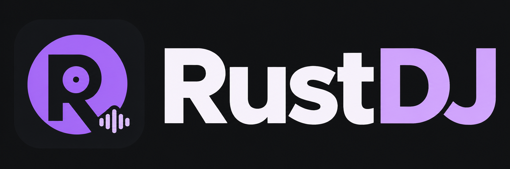

<p align="center">
  
</p>

# RustDJ 0.23

RustDJ is a native DJ application for Windows, written in Rust. It combines four
decks, a central mixer, a music browser, MIDI controller support, SHOUTcast
streaming and MP3 recording in one desktop application.


The interface, tooltips, dialogs and application messages are in English.
The violet RustDJ logo appears in the header. The application icon is embedded
in both the window and the Windows executable, with multiple sizes for Explorer
and the taskbar. No external image files are needed to run the EXE.

## Features

- Four independent decks, arranged **1 · 3 · 4 · 2**.
- Deck colors: **1 purple, 3 pink, 4 turquoise, 2 yellow**.
- MP3 and FLAC playback, plus WAV, Ogg, M4A, AAC and AIFF decoding.
- Detailed, scrolling waveforms with separate colors for low, mid and high frequencies.
- A file browser with BPM, musical key and a persistent SQLite analysis cache.
- Saved M3U8 playlists, a session sidelist and drag-and-drop loading.
- Eight saved hotcues and eight direct beat-loop buttons per deck.
- Per-deck gain, three-band EQ, channel fader, headphone cue, filter and effects.
- A switchable crossfader and an additional saved 10-band master equalizer.
- Independent master and headphone output devices/channel pairs with stereo meters.
- Model-specific Pioneer, Roland and Numark profiles, auto-connect, saved custom
  mappings, JSON import/export, MIDI learn and supported LED feedback.
- Original Pioneer DDJ-SX profile with four native decks, mixer, hotcues,
  direct loop pads and banked FX; see [DDJ-SX setup](CONTROLLERS.md#pioneer-ddj-sx-setup).
- SHOUTcast-compatible broadcasting with verified TLS, optional HTTPS track titles
  and independent MP3 recording.

## Getting started

Build the application as described under [Building from source](#building-from-source),
then start `target\release\rustdj.exe`. The release executable does not require
Rust to be installed on the playback computer.

1. Open **Audio / Outputs** and select the master output for your speakers.
2. Select a separate headphone device or a different stereo channel pair.
3. Use **Folder …** in the music browser to choose your music folder.
4. Select a track and click **1**, **3**, **4** or **2**, or drag it onto a deck.
5. Press **PLAY**. Adjust channel levels and the always-visible **MASTER** control.

The header shows the controller as **ON** or **OFF**, the selected sound cards
and their channel pairs. Connect the DJ-202 by USB before or after starting
RustDJ; automatic connection is enabled by default.

## Layout and mixing

Decks, mixer channels and scrolling waveform lanes follow the same order:

```text
Deck 1   Deck 3   [ central mixer ]   Deck 4   Deck 2
purple   pink                         turquoise yellow
```

Each mixer channel has **HIGH**, **MID** and **LOW** EQ controls stacked
vertically. **GAIN**, the channel fader, its meter and headphone **CUE** sit
alongside them. Gain and the three EQ bands range from -24 to +12 dB.
Double-click an EQ or gain knob to reset it to 0 dB.

**MASTER**, **HEADPHONES** and **CUE / MASTER** remain visible in both central
mixer tabs. Their values are saved automatically.

- **MASTER** controls the speaker mix, SHOUTcast stream and MP3 recording.
- **HEADPHONES** controls the selected headphone output.
- **CUE / MASTER** blends pre-fader cue audio with the program mix in headphones.
  The headphone program mix is taken before the software master level, so it
  remains available when MASTER is at zero.
- Channel **CUE** enables pre-fader monitoring independently of the channel fader
  and crossfader. Play the track or hold transport CUE to hear a preview.

The crossfader groups decks **1/3** on the left and **4/2** on the right. Turning
**CROSSFADER** off centers it and ignores MIDI, keyboard and mouse position
changes. All four channel faders remain independent. Re-enabling it starts from
the center. The enabled/disabled setting is saved.

Channel meters show peak levels after gain/EQ and before the channel fader.
Master and headphone stereo meters measure the actual summed output on each
selected channel pair. Numeric values are in dBFS; silence appears as
**-infinity** and **CLIP** indicates peaks at or above 0 dBFS.

### Master equalizer

Click **EQ** in the central mixer to open the additional **10-Band Master
Equalizer**. It provides ten bands at approximately 31, 63, 125, 250 and 500 Hz,
and 1, 2, 4, 8 and 16 kHz, each with -12 to +12 dB of adjustment. There is also
a preamp, an enable switch and **Flat / Reset**.

The master EQ processes the combined speaker output, stream and recording.
Direct headphone cue remains independent. Enable state, preamp and all band
values are saved and restored after restarting or changing audio devices.

### Filters and effects

Each deck has a combined low-pass/high-pass **FILTER**: center is off, left is
low-pass and right is high-pass. Three effect buttons enable **Flanger**, **Reverb**
and **Echo**, with one shared **FX LEVEL** control per deck. The compact button
labels are **FLG**, **REV** and **ECHO**. Double-click a control to reset it.
Changes are smoothed and affect both master and cue audio.

## Music browser and analysis

The browser shows drives, folders and supported music files. Use **Up** to open
the parent folder, **Go** to open a typed path, and **Favorite +** to bookmark the
current folder. The last folder and favorites are saved between sessions.
Double-click a folder to open it. Search filters the current folder without
recursively scanning subfolders.

The file list includes duration, BPM, key, analysis state, format and size.
BPM and key detection are estimates; check them before relying on Sync or
harmonic mixing. Key information includes conventional notation and Camelot.

- **Analyze selection** analyzes selected audio.
- **Reanalyze selection** replaces the cached result for that selection.
- **Analyze missing (N)** processes new or changed files in the current folder.
- The progress bar shows completed files and the current track. **Cancel** stops
  the queue; completed results remain available.

Analysis runs in background workers. The SQLite database caches BPM, key,
waveform data and file fingerprints. Unchanged files reuse saved results;
changed files or analysis versions are analyzed again. Older cached tracks can
have their detailed frequency waveforms added when loaded.

The large waveform area scrolls during playback. Use **+ / -** to change the
visible time range from 1 to 16 seconds; the default is 4 seconds. Low frequencies
are purple, mids are green and highs are light purple, independently of deck
accent colors. Close zoom levels show additional beat subdivisions. Small deck
waveforms give a full-track overview.

## Playlists and drag-and-drop

Use **PLAYLIST** to create, load or save an M3U8 playlist. **Save as …** chooses a
new file. RustDJ asks how to handle unsaved changes before replacing a playlist.
M3U/M3U8 files must be UTF-8 encoded and reference local music; HLS streams and
remote URLs are not supported.

**+ Files …** adds multiple tracks. **Up**, **Down**, **Remove** and dragging let
you organize entries. Playlists preserve order and allow repeated tracks.
Missing files remain visible with a warning so their paths can be corrected.
Relative paths, spaces and Unicode names are supported.

**SESSION / SIDELIST** contains tracks successfully loaded during this session,
with each path listed once. Search filters the session list. The sidelist width
can be changed using its divider.

Drag tracks from the browser, playlist or sidelist onto any deck. Drop tracks
onto **PLAYLIST** or **SESSION**, including their tabs, to add them to a list.
An insertion line shows where a playlist item will be placed. Dragging within a
playlist reorders it; dragging onto a deck loads it. Adding tracks to a list does
not start playback or remove the original files. Escape cancels an active drag.

Files from Windows Explorer can also be dropped onto decks and lists. Dropping
multiple files onto a deck loads up to four decks in display order, starting at
the target. Dropping a folder opens it in the music browser.

## Transport, hotcues, loops and Sync

Every deck has PLAY/PAUSE, STOP, transport CUE, tempo and Sync controls.
Hold transport **CUE** to preview from the cue point; releasing returns to it.
Pressing PLAY while cueing latches playback. Right-click transport CUE to set
the cue point. This differs from the mixer headphone CUE switch.

Eight hotcue buttons are available per deck. An empty button saves the current
position; an assigned button jumps to it and starts playback. Shift-click or
right-click clears a hotcue. Hotcues are stored per file in SQLite and restored
when the unchanged file is loaded again.

The eight direct loop buttons select **1/4, 1/2, 1, 2, 4, 8, 16 or 32 beats**.
Valid BPM is required. Press the active length again to exit, or another length
to resize the loop. The DJ-202 PARAM -/+ buttons halve or double its length.
Prepared PCM loops repeat on both master and headphones without a UI-thread
seek at each boundary. Manual IN/OUT, reloop and additional actions remain
available through MIDI learn.

Use a deck's BPM menu to set or correct BPM, halve/double it, tap tempo or set
the beat at the current position. Tempo ranges from 50% to 200%. Sync chooses
another loaded deck as reference, preferring a playing deck with a higher master
contribution. Multiple decks can follow a reference. Manual tempo changes,
jogging, hotcue jumps and loop jumps release that deck's Sync relationship.

## Audio outputs and headphone monitoring

**Audio / Outputs** lets you choose the master device and a separate monitoring
output. With two stereo devices, select channels 1/2 on each. With a multichannel
interface, use different pairs, such as master 1/2 and phones 3/4. The Windows
driver must expose the needed channels. Overlapping pairs on one device are
rejected. Missing devices are not silently replaced with other outputs.

The **MASTER / PHONES** mixer tab also provides a headphone device/pair selector.
Click **Apply** to save and use that output. The master selection remains intact.
Click **…** or the headphone status in the header to open all audio settings.

To preview a second track while one is playing publicly:

1. Load the second track and close its channel fader.
2. Enable that channel's mixer **CUE**.
3. Move **CUE / MASTER** toward Cue and raise **HEADPHONES**.
4. Play the second track or hold its transport CUE.

Different sound cards and Bluetooth devices may have different latencies.
RustDJ tracks both playback clocks and corrects headphone drift without moving
the public master. Stop streaming and recording before changing audio routing.

## Controller profiles and MIDI

**Controller / MIDI** provides model-specific presets for Pioneer DDJ-400,
DDJ-FLX4 and DDJ-SX, Roland DJ-202 and DJ-505, Numark Mixtrack (Pro) 3 and Mixtrack Platinum
FX. **Generic MIDI / Learn** starts without assumed manufacturer addresses.
See [CONTROLLERS.md](CONTROLLERS.md) for the exact scope and source references.

Choose **Automatic (known models)** or select a profile explicitly. Automatic
connection uses a saved preferred port, or exactly one matching supported device.
If several supported devices are present, choose a port manually. Unknown devices
are not auto-connected; when connected manually they use Generic MIDI / Learn.

Every model keeps its own learned bindings, including empty mappings. Switching
profiles preserves changes and releases held Cue controls. **Reset profile**
restores only the selected model's defaults. **Export JSON …** saves a RustDJ
profile and **Import JSON …** loads a validated one. Import rejects unsupported
versions, overlapping addresses, invalid deck/pad indices and oversized files.
The format is specific to RustDJ; Mixxx XML and rekordbox presets are not imported.

Initialization and LED output are sent only when the selected profile matches
the actual port's model. Pioneer and Numark cannot accidentally receive Roland's
pad unlock commands. Each profile uses its documented resolution, relative
encoder format and tempo direction. Audio routing remains a separate setting;
choose sound cards and channel pairs in **Audio / Outputs**.

These are USB MIDI presets with automated message tests, not a guarantee that
every hardware function is supported. HID-only equipment, DVS, proprietary jog
displays, hardware sequencers and standalone analog mixer paths are not covered.
Physical verification of the additional models remains outstanding.

### Existing Roland DJ-202 support

RustDJ automatically discovers the DJ-202 and reconnects after USB disconnection.
**Controller / MIDI** allows manual device selection, connection, disconnection,
refreshing ports and disabling auto-connect. A manually selected preferred port
is remembered; another unrelated MIDI device is not used as a fallback.

The left **DECK 3** button switches decks **1/3**, and the right **DECK 4** button
switches **2/4**. Native MIDI channels map directly to their numbered decks in
both switch directions. Shared FX and Load controls follow the selected bank.
Held transport CUE is released on its original deck even after a bank switch.

The profile covers transport, jog, tempo, gain, three-band EQ, channel faders,
filter, FX, headphone CUE, browser navigation, loading and all eight hotcue/loop
pads. Play, Sync, cue, pad and bank LEDs reflect software state when the MIDI
output is available. Older profiles are extended while custom mappings remain.

Press **HOT CUE** or **LOOP** on the controller before using pads 1–8. HOT CUE
sets an empty slot or triggers an assigned one; SHIFT+pad clears it. LOOP uses
the eight direct lengths. RustDJ unlocks the controller's pad layers and displays
the reported pad mode in the MIDI window. Initialization/output errors are shown.

**MIDI-LEARN** supports assigning actions to other controls. Select an action,
choose the appropriate button/fader or relative-encoder mode, click **Learn**,
and move or press the control. The last MIDI bytes and action help diagnose
assignments. **Reset profile** restores defaults for the active model.

The DJ-202's physical MASTER LEVEL is a hardware output control; a software MIDI
CC is not invented for it. Use RustDJ's MASTER control when sending to another
sound card. Hardware and software headphone levels may both affect listening
volume. The base profile includes Phones CC 0C and Mixing CC 0D if the device
sends them. Controllers that transmit a master CC can assign it with MIDI learn.

MIDI addresses were researched from the
[controller author's mapping](https://github.com/Lykos153/mixxx/tree/Mapping-DJ-202/res/controllers)
and [Mixxx device article](https://github.com/mixxxdj/mixxx/wiki/Roland-Dj-202).
The Rust implementation is independent. See also the
[DJ-202 mixer controls](https://virtualdj.com/manuals/hardware/roland/dj202/layout/mixer.html).
A complete physical test of every DJ-202 control is still outstanding.

## SHOUTcast streaming and MP3 recording

Click **STREAMER** in the central mixer to open **SHOUTcast / MP3 Recording**.
Both features capture the stereo master after channel processing, crossfader,
master level and master EQ. Direct headphone cue is excluded. Muting the
software master also mutes the stream and recording.

Enter the hostname/IP, source port, metadata/admin port, stream ID, source
password and optional station details. **TLS (certificate verified)** is the
default transport for both the source connection and HTTPS metadata updates,
including when loading settings saved by older versions. Use your provider's
TLS-enabled ports and a hostname matching the certificate. Legacy ports such as
8001/8000 may not support TLS. The source protocol is SHOUTcast 1-compatible and
supports DNAS 2 stream IDs; TLS requires a compatible source endpoint or a TLS
proxy. RustDJ is a source client, not a built-in listener server.

TLS 1.2/1.3 uses rustls and bundled Mozilla trust roots. The certificate chain,
validity and hostname/IP are checked before sending any source password or
metadata request. Invalid, expired and untrusted certificates abort the affected
connection. There is no automatic fallback to plaintext and no certificate
verification bypass. A TLS failure does not interrupt an independent MP3 recording.

**Unencrypted legacy TCP / HTTP** must be selected explicitly. A warning remains
visible and the start button changes to **Start unencrypted stream**. In this
mode, both source credentials and metadata credentials are visible to anyone
able to read the network traffic. Use it only on a trusted local connection or
inside a separately secured tunnel. See [SECURITY.md](SECURITY.md).

Enable **Send track titles to the server** for optional metadata. Automatic mode
uses the filename-derived title of the playing deck with the highest master
contribution; a manual title is also available. A metadata error does not stop
the audio stream. The source password is also used for metadata updates, so the
server must permit it for that purpose. The SHOUTcast admin API still receives
the password as a query parameter inside HTTPS. TLS hides it on the wire;
server or reverse-proxy access logs may record the URL and must redact it.

MP3 output is stereo at 44.1 kHz with selectable CBR **128, 192, 256 or 320 kbit/s**.
Bitrate changes apply to newly started sessions. Streaming and recording run
independently. A stream connection failure does not stop an active recording.

Choose a recording folder and click **Start MP3 recording**. The default for new
settings is `Music\RustDJ-Recordings` in the Windows user folder. Files are named
`RustDJ-Master-<timestamp>-<number>.mp3`; existing files are not overwritten.
**Stop recording** finalizes the MP3. Close normally to allow pending data to flush.

Settings are saved, including transport security, ports, station details, title options, bitrate and
recording folder. The password is encrypted with Windows DPAPI for the current
user account and restored at startup. A password restoration error is shown;
there is no plaintext fallback. Streaming and recording never start automatically.

Audio capture uses bounded buffers and background encoding/network workers;
the audio callback does not perform disk or network I/O. Overflow or connection
errors stop the affected output and appear in the streamer window.

## Keyboard shortcuts

| Key | Action |
| --- | --- |
| 1 / 2 / 3 / 4 | Select the active deck |
| A / B | Aliases for decks 1 / 2 |
| Space | Play/pause the active deck |
| S | Toggle Sync for the active deck |
| C | Return to the transport cue point and pause |
| Escape | Stop all decks and reset their positions |
| Left / Right arrow | Move the crossfader when enabled |

Clicking a deck selects it. Playback shortcuts are suppressed while entering
text. Transport cue points, manual BPM corrections and the session sidelist
last only for the current session; saved hotcues and library analyses persist.

## Settings and data

On Windows, preferences are stored in `%APPDATA%\RustDJ\settings.json`, including
browser favorites, MIDI mappings, preferred controller, audio routing, mix
levels, crossfader state, master EQ and streamer settings. Existing settings
continue to work after the English-language update; user paths and titles are
not translated or renamed.

Library analyses, waveform data and hotcues are stored in SQLite under the
application data folder. The database code also supports `RUSTDJ_DATA_DIR` for
an explicit library data location.

## Building from source

Requirements: Windows, Rust with the MSVC target, Visual Studio C++ Build Tools
and the Windows SDK. `rust-toolchain.toml` pins Rust 1.99.1 with rustfmt and
Clippy. Cargo downloads dependencies using the versions in `Cargo.lock`.

```powershell
git clone https://github.com/DDynamic-Evolution/RustDJ.git
cd RustDJ
.\dev.ps1 run
.\dev.ps1 clippy
.\dev.ps1 build -Release
```

With a regular Rust installation, `cargo run` and `cargo build --release` also
work. `dev.ps1` uses an existing local `.tools` toolchain when available.

The two targeted DDJ-SX regression tests for version 0.23 run with:

```powershell
cargo test --lib sx23_
```

They include the existing controller-profile regressions and exercise all
preset bindings, native SX deck/pad channels, 14-bit mixer/filter/tempo,
FX bank isolation, Cue release after deck/profile changes, saved mappings,
JSON import/export and model detection (including SX2/SX3 exclusion). Existing TLS security
regressions remain available through `cargo test --lib tls20_`.
The MIDI bank regression can also be run with `cargo test --lib regression18_native`.
A full test run is available through `cargo test` or `.\dev.ps1 test`.
The hardware audio test is ignored by default and can be requested with
`cargo test --test audio_device -- --ignored --nocapture`.

The original demo WAV files are generated with `python scripts/generate_demos.py`.
The committed compressed test fixtures can be regenerated with FFmpeg:

```powershell
ffmpeg -y -i assets/demo-a.wav -c:a libmp3lame -b:a 192k assets/demo-a.mp3
ffmpeg -y -i assets/demo-b.wav -c:a flac assets/demo-b.flac
```

Build files, tokens, recordings and local settings are excluded by `.gitignore`.
The `work/` folder is used for local checks and packaging and is not committed.

## Project structure

| Module | Purpose |
| --- | --- |
| `app`, `browser`, `playlist`, `dragdrop` | Desktop UI and library workflow |
| `branding`, `assets/branding`, `build.rs` | Embedded logo, window icon and Windows executable resources |
| `audio`, `output`, `dsp`, `effects`, `equalizer`, `loops` | Playback, routing and signal processing |
| `midi`, `decks` | Controller mapping and deck identity |
| `track`, `analysis`, `beat`, `key`, `waveform` | Decoding and track analysis |
| `database`, `performance`, `settings`, `credentials` | Cached data and saved preferences |
| `capture`, `streamer`, `stream_transport` | Master capture, verified TLS, SHOUTcast and MP3 recording |

The GUI uses eframe/egui. Playback uses rodio/Symphonia, MIDI uses midir, SQLite
uses rusqlite, and background MP3 encoding uses LAME through mp3lame-encoder.
The three-band channel EQ follows the
[W3C Audio EQ Cookbook](https://www.w3.org/TR/audio-eq-cookbook/).
See [THIRD_PARTY_NOTICES.md](THIRD_PARTY_NOTICES.md) and
[third_party/licenses](third_party/licenses) for MP3 encoder notices and licenses.
Matching source packages include the exact MP3 encoder and native LAME sources
so the application can be rebuilt and relinked with modified libraries.

## Current limitations

RustDJ is under active development. BPM/key estimates and Sync depend on the
material and beat grid. Audio device latency can vary. A complete hardware
verification of every DJ-202 function is still required. Features such as
stems, video mixing, timecode control and ASIO are not implemented.
